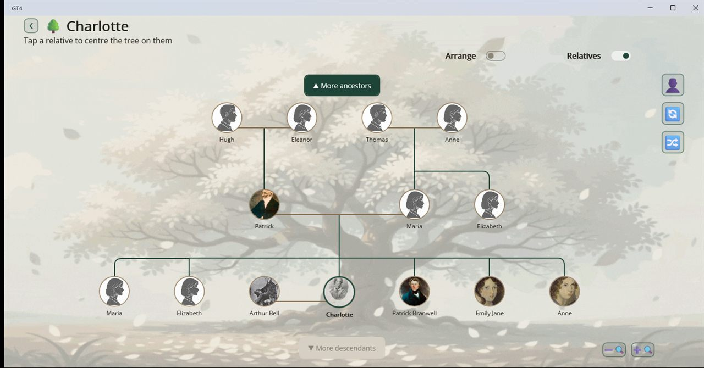

# Genealogy Tree (GT4)

A family tree application that keeps your research on your own machine. A project is a single local
file: no account, no cloud sync, no analytics, no ads.

[Get it from the Microsoft Store](https://apps.microsoft.com/detail/9MV3J705L3QP) ·
[Website](https://gasizdat.github.io/GT4/) ·
[User guide](https://gasizdat.github.io/GT4/guide.html) ·
[Sample exported site](https://gasizdat.github.io/GT4/sample/) ·
[Privacy policy](https://gasizdat.github.io/GT4/privacy.html)



## What it does

- **Family tree and fan chart** — a zoomable, pannable pedigree of ancestors and descendants,
  re-centred on any relative with a click, and a fan chart of up to ten generations of ancestors.
- **A page for every person** — a main portrait and extra photos, a formatted biography, captioned
  attachments, and an expandable tree of relatives.
- **GEDCOM 5.5.1 import and export** — tags the app doesn't model natively are carried through the
  round trip rather than dropped, photos and attachments included.
- **Kinship finder** — the relationship between any two people, plus the chain of relatives that
  connects them.
- **Dates as you actually have them** — approximate and unknown dates are first-class, entered and
  displayed in the Gregorian, Julian, Hebrew or French Republican calendar.
- **Date calendar, statistics, gallery, filters** — anniversaries by day of the year, over twenty
  project statistics, every photo and attachment in one place, and wildcard name filters.
- **Photo enhancement on your own PC** — enlarge a small scan, colorize a black-and-white photo or
  repair scratches; the result is saved as a copy beside the original.
- **Export as a website** — the whole project as a self-contained HTML site that opens in any
  browser without the app.
- **Restore points, read-only mode, multiple projects**, a built-in Brontë family demo tree, light
  and dark themes, app-wide text scaling.

The interface is available in English, Russian, German, Spanish and French.

## Platforms

Windows is the shipping platform, installed from the Microsoft Store listing above. Each
[release](https://github.com/gasizdat/GT4/releases) also carries the MSIX, signed with a throwaway
certificate for pre-upload verification; `install-release.ps1` sideloads it. The same .NET MAUI
application also builds for Android, which is not published yet.

## Building from source

You need the .NET 10 SDK; the Android head also needs the Android workload. Everything below runs
from the repository root in PowerShell.

```powershell
# Libraries, tools and unit tests
dotnet build GT4.CI.slnf -c Release

# The Windows app and its device tests
dotnet build GT4.CI.Windows.slnf -c Release --framework net10.0-windows10.0.19041.0
```

To run and debug the app, open `GT4.Windows.slnf` (or `GT4.Android.slnf`) in Visual Studio and start
`AppWinOnly` (or `AppAndroidOnly`).

## Running the tests

```powershell
# One unit-test project
dotnet test Tests\GT4.Core.Project.Tests\GT4.Core.Project.Tests.csproj --no-build -c Release

# The device tests, which drive the real pages in a WinUI host; they refuse a Debug build
dotnet test Tests\GT4.UI.App.DeviceTests\GT4.UI.App.DeviceTests.csproj --no-build -c Release --framework net10.0-windows10.0.19041.0
```

`run-tests-coverage.ps1` runs every test project with coverage, then the GEDCOM round-trip functional
tests, and opens a combined report. `run-android-device-tests.ps1` runs the device tests on an
attached Android device.

## Repository layout

| Path | Contents |
| --- | --- |
| `Core/` | MAUI-free libraries: the SQLite project store (`Core.Project`), GEDCOM import/export (`Core.Gedcom`), shared utilities |
| `UI/` | The MAUI application and its resource and utility libraries |
| `Tools/` | `RelativesCli`, a diagnostic CLI over a project or GEDCOM file, and `ModelExport`, which converts a PyTorch checkpoint to ONNX for photo enhancement |
| `Tests/` | Unit tests, device tests and the GEDCOM round-trip functional tests |
| `doc/dev/` | Architecture and subsystem documentation |
| `site/` | The project website, published to GitHub Pages |

## Documentation

Start with the [system overview](doc/dev/00-overview.md), or go to
[navigation](doc/dev/30-navigation.md) if you know the task but not which subsystem it lands in.
[CLAUDE.md](CLAUDE.md) records the delivery workflow, platform traps and rejected designs.

## License

[Apache License 2.0](LICENSE.txt)
